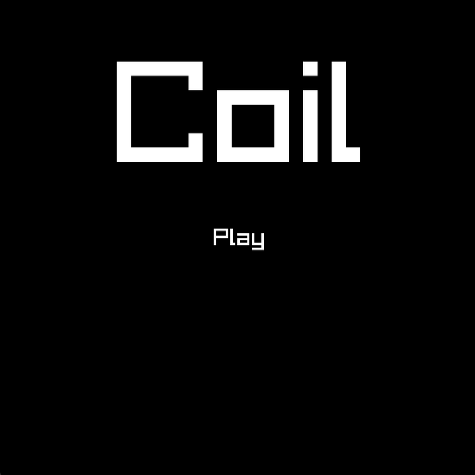
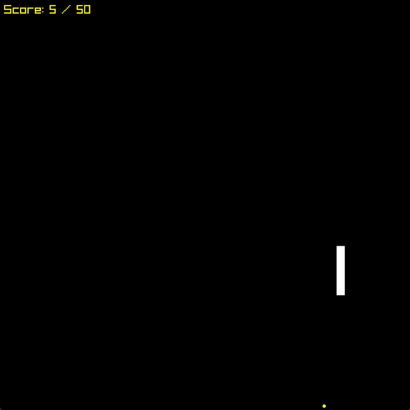
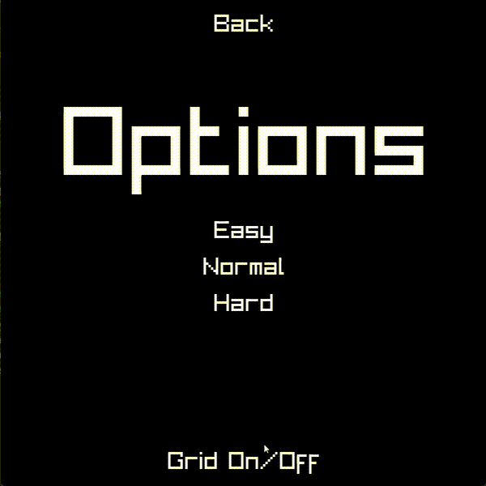
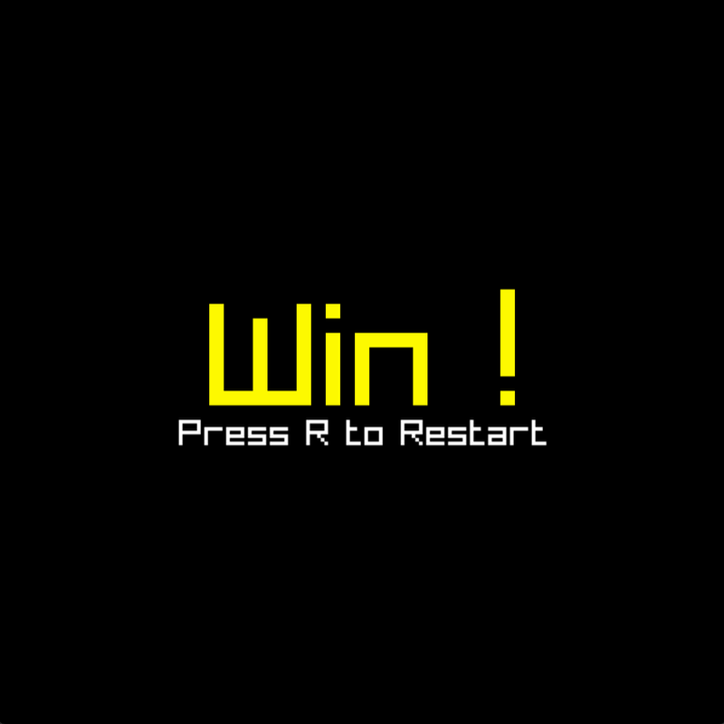
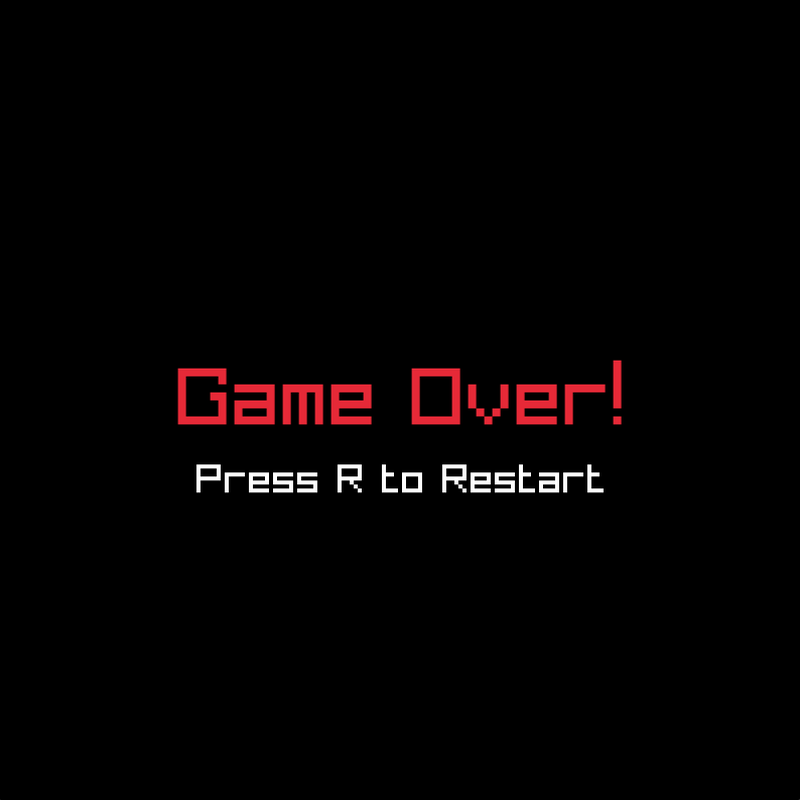

# Coil：一个用 raylib 和 C 编写的极简网格贪吃蛇游戏

[English](README.md) | 简体中文

## 简介：

Coil 是一个小型的桌面贪吃蛇游戏。蛇在 50x50 的网格上逐格移动。
和经典贪吃蛇一样，吃食物可以让蛇变长、提高分数；不要撞墙，也不要撞到自己。
达到目标分数即可获胜！

它作为一个学习项目而写：纯 C11，raylib 负责窗口与渲染，CMake 负责构建，vcpkg 管理依赖。

## 特性：

- 网格化移动，步进与帧率无关
- 三档难度（目标分数 20 / 50 / 100）
- 实时分数显示
- 胜利与失败界面，可立即重开
- 可选的测试网格叠加层，便于调试
- 自定义窗口图标；资源随构建一起复制

## 操作：

| 操作 | 按键 |
| --- | --- |
| 移动 | W / A / S / D |
| 菜单 | 鼠标 |
| 重开（胜利或失败后） | R |
| 退出 | ESC |

## 下载：

预编译的 Windows 版本见 [Releases](../../releases) 页面。

下载最新的 `Coil-v1.0-win64.zip`，解压后运行 `Coil.exe`。
请把 `raylib.dll`、`glfw3.dll` 以及 `assets` 里的文件放在可执行文件旁边。

## 从源码构建：

### 环境要求：

- Windows 10/11
- Visual Studio 2022 或 2026，带 MSVC 工具链
- CMake 3.25 或更高（若使用 `Visual Studio 18 2026` 生成器，需要 4.3+）
- vcpkg

### 步骤：

1. 用 vcpkg 安装 raylib：`vcpkg install raylib:x64-windows`
2. 把环境变量 `COIL_VCPKG_ROOT` 设为你的 vcpkg 根目录，例如 `D:\vcpkg`
3. 配置：`cmake --preset vs2026`
4. 构建：`cmake --build --preset vs2026-release`

可执行文件会生成在 `out/build/vs2026/Release`。
构建过程会把资源和所需的 DLL 复制到它旁边。

你也可以直接用 Visual Studio 打开仓库文件夹，它会读取 `CMakePresets.json`。

### 常见问题：

- **找不到 raylib** - 确认 `COIL_VCPKG_ROOT` 指向的 vcpkg 已经为 `x64-windows` 三元组装好了 raylib。
- **LNK2019：无法解析的外部符号 WinMain** - 缺少 `/ENTRY:mainCRTStartup` 链接选项；`CMakeLists.txt` 已经为 MSVC 设置。
- **窗口图标缺失** - `SnakeIcon.png` 必须和可执行文件在同一目录；构建时会从 `assets/` 复制。

## 项目结构：

- src/Code：C 源码
- src/Head：头文件 
- assets/：运行时资源
- resources/：Windows 资源（图标、.rc）

## 开发日志

开发历程见 [docs/DEVLOG.md](docs/DEVLOG.md)，版本说明见 [CHANGELOG.md](CHANGELOG.md)。

## 许可证

MIT，详见 [LICENSE](LICENSE)。

## 致谢

- [raylib](https://www.raylib.com/) - 简单易用的游戏编程库
- [vcpkg](https://vcpkg.io/) - C/C++ 包管理器
- [DeepSeek](https://www.deepseek.com/)（DeepSeek-v4.1-Flash）- 开发过程中使用的 AI 编程助手
